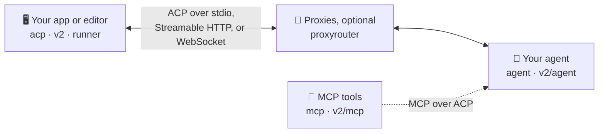

<div align="center">

# acp-go

### The Agent Client Protocol for Go

Drive AI coding agents, build your own, or proxy between them.<br>
Pure standard-library Go, wire-compatible with the reference Rust SDK.

[](https://github.com/BrokkAi/acp-go/actions/workflows/ci.yml)
[](https://github.com/BrokkAi/acp-go/releases)
[](https://pkg.go.dev/github.com/BrokkAi/acp-go)
[](go.mod)
[](licenses/README.md)
[](ROADMAP.md)
[](LICENSE)

[Quick start](#-quick-start) · [Why acp-go](#-why-acp-go) · [Protocol support](#-protocol-support) · [Packages](#-packages) · [Docs](#-documentation) · [Changelog](CHANGELOG.md)

</div>

---

The [Agent Client Protocol](https://agentclientprotocol.com) (ACP) does for AI
coding agents what LSP did for language servers: one JSON-RPC protocol between
the tools people work in and the agents they drive, such as Claude Code and
Codex (through their ACP adapters) or Gemini CLI. **acp-go** implements the
whole protocol in Go, so you can run any ACP agent from a Go program, ship
your own agent, or sit in between as a proxy.

```sh
go get github.com/BrokkAi/acp-go@latest
```

> [!TIP]
> **New in [v0.14.0](CHANGELOG.md#0140---2026-11-19):** behavior tracks Rust
> `agent-client-protocol` 5.4.0. It adds client-provided system prompts on the
> stable surfaces, retry-safe prompts with idempotency keys, `replay_complete`,
> stable draft-v2 subagent sessions, `session/options`, and connections that
> survive invalid UTF-8.



## ✨ Why acp-go

- 🪶 **Zero dependencies.** Only the Go standard library, enforced by the
  license and dependency policy check in CI. Nothing to audit or vendor.
- 🦀 **Wire-exact with the reference SDK.** Over 14,000 decode and encode
  cases, captured from the Rust schema crate itself, prove that every
  generated type accepts, rejects, and writes JSON exactly as Rust does, down
  to the error text.
- 🎭 **Every role.** A client, an agent runtime, a process runner that manages
  an agent end to end, and routers that serve or reach v1 and v2 from one
  endpoint.
- 🧭 **Every protocol surface.** Stable ACP v1, draft ACP v2, and the unstable
  features, each behind its own explicit import.
- 🔌 **Every transport.** Newline-delimited stdio by default, plus Streamable
  HTTP and WebSocket built on `net/http`.
- 🧰 **Batteries included.** An MCP server framework with MCP-over-ACP, a
  deterministic test harness, a sequence-diagram trace viewer, and a cookbook
  of runnable recipes.
- ✅ **Tested where you run it.** CI runs the race-enabled suite on Linux,
  macOS, and Windows. The fuzz seed corpus runs with every test run, and a
  weekly fuzzing campaign and opt-in integration tests against real agents
  (the Claude and Codex ACP adapters) cover the rest.

## 🚀 Quick start

Requires Go 1.27.1 or newer.

### Run any ACP agent from Go

`runner` launches the agent process, answers its file and terminal requests
inside your workspace, keeps a JSONL transcript, and returns the final text:

```go
package main

import (
	"context"
	"fmt"
	"log"

	"github.com/BrokkAi/acp-go"
	"github.com/BrokkAi/acp-go/runner"
)

func main() {
	answer, err := runner.Runner{Config: runner.Config{
		Directory:      "/path/to/workspace",
		StateDirectory: "/path/to/state", // private JSONL transcripts
		Agent:          runner.AgentConfig{Command: []string{"npx", "-y", "@agentclientprotocol/claude-agent-acp"}},
		ClientInfo:     acp.ClientInfo{Name: "my-app", Version: "1.0.0"},
	}}.Execute(context.Background(), "Summarize this repository in three bullets.")
	if err != nil {
		log.Fatal(err)
	}
	fmt.Println(answer)
}
```

Permission requests are answered as cancelled unless you set `AutoApprove`.
The runner is not an OS sandbox; see [docs/runner.md](docs/runner.md).

### Build an agent

Implement three methods and serve over stdio. The runtime takes care of
initialization, version negotiation, capability checks, cancellation, and
error answers:

```go
package main

import (
	"context"
	"os"

	"github.com/BrokkAi/acp-go/agent"
	"github.com/BrokkAi/acp-go/schema"
)

type echoAgent struct{}

func (echoAgent) Initialize(context.Context, agent.Client, schema.InitializeRequest) (schema.InitializeResponse, error) {
	return schema.InitializeResponse{ProtocolVersion: 1}, nil
}

func (echoAgent) NewSession(context.Context, agent.Client, schema.NewSessionRequest) (schema.NewSessionResponse, error) {
	return schema.NewSessionResponse{SessionID: "session-1"}, nil
}

func (echoAgent) Prompt(_ context.Context, _ agent.Client, request schema.PromptRequest, updates agent.SessionUpdater) (schema.PromptResponse, error) {
	// Stream the reply as session/update notifications, then end the turn.
	for _, block := range request.Prompt {
		if err := updates.Update(schema.SessionUpdate{AgentMessageChunk: &schema.ContentChunk{Content: block}}); err != nil {
			return schema.PromptResponse{}, err
		}
	}
	return schema.PromptResponse{StopReason: schema.StopReasonEndTurn}, nil
}

func main() {
	if err := agent.New(echoAgent{}).Serve(context.Background(), os.Stdin, os.Stdout); err != nil {
		panic(err)
	}
}
```

Implement optional interfaces such as `SessionLoader`, `SessionResumer`,
`SessionCloser`, `ModeSetter`, and `ConfigOptionSetter` to serve more of the
protocol. See [docs/agent-runtime.md](docs/agent-runtime.md).

<details>
<summary><b>Drive a connection yourself (v1)</b></summary>

<br>

```go
connection := acp.Connect(agentStdout, agentStdin, handleRequest, handleUpdate)
defer connection.Close()

initialization, err := connection.InitializeWithInfo(ctx, acp.Capabilities{}, acp.ClientInfo{
	Name: "my-app", Version: "1.0.0",
})
session, err := connection.NewSessionWithOptions(ctx, initialization, workspace, acp.NewSessionOptions{
	SystemPrompt: acp.NewTextSystemPrompt("Answer in one sentence."), // when the agent supports it
})
stopReason, err := connection.Prompt(ctx, session, "Inspect the project")

// After a successful run, write what is still queued before stdin closes.
err = connection.Shutdown(ctx)
```

Every optional field is checked against the agent's advertised capabilities
before anything is written. See [docs/client.md](docs/client.md).

</details>

<details>
<summary><b>Retry-safe prompts with draft ACP v2</b></summary>

<br>

In ACP v2, `session/prompt` returns once the agent inserts your message, and
completion arrives later as an idle state update. An idempotency key makes a
retry after a lost response safe:

```go
connection := acpv2.Connect(agentStdout, agentStdin, nil, handleUpdate)
initialization, err := connection.InitializeWithInfo(ctx, acpv2.Capabilities{}, acpv2.ClientInfo{Name: "my-app", Version: "1.0.0"})
session, err := connection.NewSessionWithOptions(ctx, initialization, workspace, acpv2.NewSessionOptions{})

// One key per submission: the agent inserts at most one message for it.
key := acpv2.NewIdempotencyKey()
prompt := []acpv2.Content{acpv2.NewTextContent("Refactor the parser")}
messageID, err := connection.PromptContentWithKey(ctx, initialization, session, prompt, key)
if err != nil {
	messageID, err = connection.PromptContentWithKey(ctx, initialization, session, prompt, key) // safe to retry
}
```

`SessionHandle` and `SessionTracker` add Rust-shaped session commands, update
projections, and work tracking. See [docs/draft-v2.md](docs/draft-v2.md).

</details>

### Try the examples

```sh
# v1 client talking to the minimal agent
go run ./examples/minimal-client -agent-command 'go run ./examples/minimal-agent' -prompt hello

# CLI driver with mode, model, effort, and auth options; swap in a real agent command
go run ./examples/drive-cli -command 'go run ./examples/minimal-agent' -prompt hello

# Draft v2 one-shot client and agent
go run ./examples/v2-one-shot-client -command 'go run ./examples/minimal-agent-v2' -prompt 'Say hello using draft ACP v2.'
```

The [cookbook](cookbook/doc.go), ported from the reference Rust cookbook,
covers one-shot prompts, ordered dispatch, session coordination, proxies, and
MCP servers: `go doc github.com/BrokkAi/acp-go/cookbook`. Every recipe is a
runnable example that `go test ./...` executes.

## 🧭 Protocol support

| Surface | Status | Pinned to |
|---|---|---|
| ACP v1 | ✅ Stable | `schema-v1.33.0` |
| ACP v2 | 🧪 Draft, separate packages | `schema-v2.0.0-alpha.17` |
| Unstable ACP features | 🔒 Opt-in packages only | Rust schema crate 1.19.0 unstable artifacts |
| Streamable HTTP and WebSocket | 🧪 Draft, opt-in | `agent-client-protocol-http` 5.4.0 |

Every schema pin is the exact artifact set of Rust schema crate 1.19.0, which
Rust `agent-client-protocol` 5.4.0 pins.

| Area | What you get |
|---|---|
| Sessions | New, load, resume, list, close, and delete; modes and config options; additional workspace directories |
| Prompts | Text, image, audio, and resource content; streamed session updates; cancellation |
| Client host | Workspace-confined file system and terminals, a permission policy, and JSONL transcripts (`clienthost`) |
| Interaction | Typed permission and elicitation handlers on both protocol versions |
| System prompts | Client-provided instructions on session setup, checked against what the agent advertises (stable since schema 1.16) |
| Draft v2 | Prompt acceptance, idempotency keys, `replay_complete`, subagent sessions, background work, per-entity cancellation |
| MCP | MCP servers on sessions, MCP-over-ACP, and a standard-library MCP server framework |
| Unstable | Facades for `session/options`, fork, archive, status, titles, LLM providers, auth status, plan and usage projection, and v1 subagents; proxy chains through `proxyrouter`; generated types for session cursors, prompt suggestions, and agent skills |

During the `0.x` series, minor releases may contain breaking API changes; the
[changelog](CHANGELOG.md) lists every one. Use `@master` for unreleased
changes.

## 📦 Packages

All paths are under `github.com/BrokkAi/acp-go`. The root package's name is
`acp`.

| Package | Purpose | Docs |
|---|---|---|
| `.` (`acp`) | v1 client and the JSON-RPC connection every role uses | [client](docs/client.md), [connection](docs/connection.md) |
| `agent` | v1 agent runtime over stdio, plus typed client host adapters | [agent runtime](docs/agent-runtime.md) |
| `clienthost` | Workspace-confined reference host: rooted filesystem, terminals, auto-approval, transcripts | [agent runtime](docs/agent-runtime.md#client-hosts) |
| `runner` | Runs an agent process end to end and returns its text | [runner](docs/runner.md) |
| `schema` | Generated v1 wire types and method registry | [connection](docs/connection.md#generated-schema-types), [schema pins](docs/schema-pin-workflow.md) |
| `jsonvalue` | Untyped JSON held as `serde_json` holds it (backs `_meta`) | [connection](docs/connection.md#_meta-and-untyped-json) |
| `tracecontext` | W3C Trace Context in `_meta` | [connection](docs/connection.md#trace-context) |
| `v2`, `v2/agent`, `v2/runner`, `schema/v2` | Draft ACP v2 client, agent runtime, one-shot runner, subagent sessions, and wire types | [draft v2](docs/draft-v2.md) |
| `agentrouter`, `clientrouter`, `proxyrouter` | Serve or reach v1 and v2 from one endpoint | [draft v2](docs/draft-v2.md#version-routers) |
| `unstable`, `v2/unstable`, `schema/unstable`, `schema/v2/unstable` | Opt-in unstable features | [unstable facades](docs/unstable-facades.md) |
| `mcp`, `v2/mcp` | Opt-in MCP-over-ACP and a standard-library MCP server framework | [unstable facades](docs/unstable-facades.md#mcp-server-framework) |
| `transport/http` | Draft Streamable HTTP and WebSocket transport | [HTTP transport](docs/http-transport.md) |
| `acptest` | In-memory transport, deterministic test agent, and framing helpers for tests | `go doc` |
| `traceviewer`, `cmd/acp-trace-viewer` | Renders JSONL transcripts as a sequence diagram | [below](#-tools) |
| `cookbook` | Runnable recipes for common patterns | `go doc` |

The stable `acp`, `v2`, `schema`, and `schema/v2` packages never expose the
unstable surface.

## 🔧 Tools

**Trace viewer.** `cmd/acp-trace-viewer` renders a JSONL transcript (the
files `clienthost` writes, including the v1 runner's) as an ordered sequence
diagram, served over `net/http` from an embedded page with no external
assets. Pass `-open` to open it in your browser:

```sh
go run ./cmd/acp-trace-viewer -addr 127.0.0.1:8787 session.jsonl
```

The `traceviewer` package behind it re-reads a transcript file on every poll,
so a live session updates in place, or serves events a host pushes in memory.

**Test harness.** `acptest.NewPair` returns an in-memory duplex transport that
a v1 `acp.Connection` or a draft-v2 `v2.Connection` can drive.
`acptest.TestAgent` executes deterministic typed prompt commands, and the v1
and draft-v2 fake agents and framing helpers (`Serve`, `WriteRequest`,
`ReadResponse`) cover router tests. acp-go's own router tests use it, so the
harness cannot drift.

## 🔬 How parity is tested

Parity with the Rust SDK is tested, not assumed:

1. **Generated from the source of truth.** `cmd/acpgen` generates every wire
   type from the exact JSON Schema artifacts the Rust schema crate embeds, and
   fails loudly on constructs it cannot model rather than guessing.
2. **Captured from Rust.** A probe built on the pinned Rust crate decodes
   thousands of generated edge cases (missing, `null`, malformed, and boundary
   values for every field, every union tag, the array forms serde accepts) and
   records the outcome. Each package's `TestDeserializeHints` requires the Go
   decoders to accept and reject the same inputs with the same error text, and
   the Go encoders to write the same bytes.
3. **Wire behavior pinned to Rust's.** Frame encoding, malformed params,
   cancellation IDs, and version negotiation are checked against outputs
   captured from the Rust SDK. The HTTP and WebSocket bindings are checked
   against raw exchanges recorded with the Rust server and client.

[docs/schema-pin-workflow.md](docs/schema-pin-workflow.md) describes the rules,
and [ROADMAP.md](ROADMAP.md) tracks what is ported and what remains.

## 📚 Documentation

| Guide | Covers |
|---|---|
| [v1 client](docs/client.md) | Features, capability checks, system prompts, session updates, elicitation |
| [Connection and wire behavior](docs/connection.md) | Handlers, error handling, frame encoding, `RPCError`, `_meta`, generated types |
| [v1 agent runtime](docs/agent-runtime.md) | Implementing an agent, capability gates, system prompts, error responses, client hosts |
| [Process runner](docs/runner.md) | Permissions, errors, process lifecycle, terminal auth |
| [Draft ACP v2](docs/draft-v2.md) | Prompt semantics, idempotency keys, subagents, projections, session tracking, routers, MCP |
| [Unstable facades](docs/unstable-facades.md) | The opt-in unstable surface and the MCP server framework |
| [Draft HTTP transport](docs/http-transport.md) | The HTTP and WebSocket binding and its limits |
| [Validation boundaries](docs/validation-boundaries.md) | Where requests are validated |
| [Schema pin workflow](docs/schema-pin-workflow.md) | Regenerating for a new schema release; decode and encode rules |
| [Rust ecosystem parity](docs/rust-ecosystem-parity.md) | Which Rust SDK crates are ported, and why |

## 🤝 Contributing

```sh
go test -race ./...
go vet ./...
```

No agent credentials are needed, and the fuzz seed corpus runs as part of the
tests. [CONTRIBUTING.md](CONTRIBUTING.md) covers schema regeneration, longer
fuzz campaigns, and opt-in tests against real ACP agents. Please follow the
[Code of Conduct](CODE_OF_CONDUCT.md), and report vulnerabilities privately
using [SECURITY.md](SECURITY.md).

**Used by.** acp-go was extracted from
[release-bot](https://github.com/BrokkAi/release-bot) and powers Brokk's
release and issue automation. Using it in your project? Open a pull request to
add it here.

## 📄 License

Licensed under [Apache-2.0](LICENSE). See [NOTICE](NOTICE) for project
attribution and [licenses/README.md](licenses/README.md) for dependency terms,
third-party notices, and the license review process.
