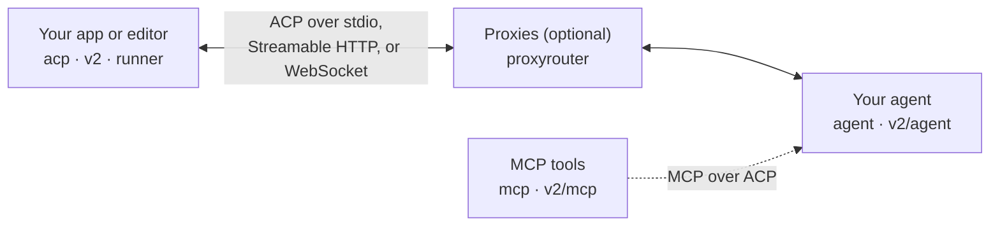

# acp-go

**The Agent Client Protocol for Go: clients, agents, proxies, and transports in
pure standard-library Go, wire-compatible with the reference Rust SDK.**

[](https://github.com/BrokkAi/acp-go/actions/workflows/ci.yml)
[](https://pkg.go.dev/github.com/BrokkAi/acp-go)
[](go.mod)
[](licenses/README.md)
[](ROADMAP.md)
[](LICENSE)

The [Agent Client Protocol](https://agentclientprotocol.com) (ACP) is to AI
coding agents what LSP is to language servers: one JSON-RPC protocol between
editors and the agents they drive, such as Claude Code, Codex, and Gemini CLI.
**acp-go** brings the whole protocol to Go, so you can drive any ACP agent from
a Go program, ship your own agent, or sit in between as a proxy.

```sh
go get github.com/BrokkAi/acp-go
```

## Why acp-go

- **Zero dependencies.** Only the Go standard library, enforced by a license
  and dependency policy check in CI. Nothing to audit, nothing to vendor.
- **Wire-exact with the reference SDK.** Behavior tracks Rust
  [`agent-client-protocol`](https://github.com/agentclientprotocol/rust-sdk)
  **5.4.0**. Over 14,000 decode and encode cases, captured from the Rust
  schema crate itself, prove that every generated type accepts, rejects, and
  writes JSON exactly as Rust does, down to the error text.
- **Every role.** A client, an agent runtime, a process runner that manages an
  agent end to end, and protocol routers that serve or reach v1 and v2 from
  one endpoint.
- **Every protocol surface.** Stable ACP v1, draft ACP v2, and the optional
  unstable features behind explicit imports.
- **Every transport.** Newline-delimited stdio by default, plus Streamable HTTP
  and WebSocket implemented on `net/http`.
- **Batteries included.** An MCP server framework with MCP-over-ACP, a
  deterministic test harness, a sequence-diagram trace viewer, and a cookbook
  of runnable recipes.



## Quick start

### Run an agent and get its answer

`runner` launches an agent process, answers its file and terminal callbacks
inside your workspace, and returns the final text:

```go
answer, err := runner.Runner{Config: runner.Config{
	Directory:      "/path/to/workspace",
	StateDirectory: "/path/to/state", // private JSONL transcripts
	Agent:          runner.AgentConfig{Command: []string{"npx", "-y", "@agentclientprotocol/claude-agent-acp"}},
	ClientInfo:     acp.ClientInfo{Name: "my-app", Version: "1.0.0"},
}}.Execute(ctx, "Summarize this repository in three bullets.")
```

Permission requests are refused unless you set `AutoApprove`. See
[docs/runner.md](docs/runner.md) for the process lifecycle and errors.

### Build an agent

Implement three methods and serve over stdio; the runtime handles
initialization, version negotiation, capability checks, cancellation, and
error answers:

```go
type echoAgent struct{}

func (echoAgent) Initialize(context.Context, agent.Client, schema.InitializeRequest) (schema.InitializeResponse, error) {
	return schema.InitializeResponse{ProtocolVersion: 1}, nil
}

func (echoAgent) NewSession(context.Context, agent.Client, schema.NewSessionRequest) (schema.NewSessionResponse, error) {
	return schema.NewSessionResponse{SessionID: "session-1"}, nil
}

func (echoAgent) Prompt(_ context.Context, _ agent.Client, request schema.PromptRequest, updates agent.SessionUpdater) (schema.PromptResponse, error) {
	// Stream the reply as session/update notifications, then end the turn.
	for _, block := range request.Prompt {
		if err := updates.Update(schema.SessionUpdate{AgentMessageChunk: &schema.ContentChunk{Content: block}}); err != nil {
			return schema.PromptResponse{}, err
		}
	}
	return schema.PromptResponse{StopReason: schema.StopReasonEndTurn}, nil
}

func main() {
	if err := agent.New(echoAgent{}).Serve(context.Background(), os.Stdin, os.Stdout); err != nil {
		panic(err)
	}
}
```

Add optional interfaces (`SessionLoader`, `SessionResumer`, `ModeSetter`, ...)
to serve more of the protocol. See [docs/agent-runtime.md](docs/agent-runtime.md).

### Drive an agent connection yourself

```go
connection := acp.Connect(agentStdout, agentStdin, handleRequest, handleUpdate)
defer connection.Close()

initialization, err := connection.InitializeWithInfo(ctx, acp.Capabilities{}, acp.ClientInfo{
	Name: "my-app", Version: "1.0.0",
})
session, err := connection.NewSessionWithOptions(ctx, initialization, workspace, acp.NewSessionOptions{
	SystemPrompt: acp.NewTextSystemPrompt("Answer in one sentence."), // when the agent supports it
})
stopReason, err := connection.Prompt(ctx, session, "Inspect the project")

// After a successful run, write what is still queued before stdin closes.
err = connection.Shutdown(ctx)
```

Every optional field is checked against the agent's advertised capabilities
before anything is written. See [docs/client.md](docs/client.md).

### Try the examples

```sh
# v1 client talking to the minimal agent
go run ./examples/minimal-client -agent-command 'go run ./examples/minimal-agent' -prompt hello

# CLI driver with mode, model, effort, and auth options; swap in a real agent command
go run ./examples/drive-cli -command 'go run ./examples/minimal-agent' -prompt hello

# Draft v2 one-shot client and agent
go run ./examples/v2-one-shot-client -command 'go run ./examples/minimal-agent-v2' -prompt 'Say hello using draft ACP v2.'
```

For more patterns (one-shot prompts, ordered dispatch, session coordination,
proxies, MCP servers), read the [cookbook](cookbook/doc.go), ported from the
reference Rust cookbook: `go doc github.com/BrokkAi/acp-go/cookbook`. Every
recipe is a runnable example that `go test ./...` executes.

## Protocol support

| Surface | Status | Pinned to |
|---|---|---|
| ACP v1 | Stable | `schema-v1.33.0` |
| ACP v2 | Draft, separate packages | `schema-v2.0.0-alpha.17` |
| Unstable ACP features | Opt-in packages only | Rust schema crate 1.19.0 unstable artifacts |
| Streamable HTTP and WebSocket transport | Draft, opt-in | `agent-client-protocol-http` 5.4.0 |

Every schema pin is the exact artifact set of Rust schema crate 1.19.0, the
crate Rust `agent-client-protocol` 5.4.0 pins. Recent protocol additions are
all supported:

- **Client-provided system prompts**, stable on both versions: typed options
  on the clients, and runtimes that refuse a prompt the agent did not
  advertise.
- **Prompt idempotency keys** (draft v2): retry `session/prompt` after a lost
  response without inserting the message twice.
- **`replay_complete`** (draft v2), which tells replayed history from live
  updates when a session resumes.
- **Subagent sessions**, background work, and per-entity cancellation in
  draft v2.
- **Unstable features** behind explicit imports: `session/options`, session
  fork, archive, status, and titles, LLM providers, auth status, plan
  operations, session cursors, prompt suggestions, agent skills,
  MCP-over-ACP, and proxy chains.

During the `0.x` series, minor releases may contain breaking API changes; the
[changelog](CHANGELOG.md) lists every one. Use `@master` for unreleased
changes.

## Packages

All paths are under `github.com/BrokkAi/acp-go`. The import path of the root
package is `github.com/BrokkAi/acp-go`; its package name is `acp`.

| Package | Purpose | Docs |
|---|---|---|
| `.` (`acp`) | v1 client and the JSON-RPC connection every role uses | [client](docs/client.md), [connection](docs/connection.md) |
| `agent` | v1 agent runtime over stdio, plus typed client host adapters | [agent runtime](docs/agent-runtime.md) |
| `clienthost` | Workspace-confined reference host: rooted filesystem, terminals, auto-approval, transcripts | [agent runtime](docs/agent-runtime.md#client-hosts) |
| `runner` | Runs an agent process end to end and returns its text | [runner](docs/runner.md) |
| `schema` | Generated v1 wire types and method registry | [connection](docs/connection.md#generated-schema-types), [schema pins](docs/schema-pin-workflow.md) |
| `jsonvalue` | Untyped JSON held as `serde_json` holds it (backs `_meta`) | [connection](docs/connection.md#_meta-and-untyped-json) |
| `tracecontext` | W3C Trace Context in `_meta` | [connection](docs/connection.md#trace-context) |
| `v2`, `v2/agent`, `v2/runner`, `schema/v2` | Draft ACP v2 client, agent runtime, one-shot runner, and wire types | [draft v2](docs/draft-v2.md) |
| `agentrouter`, `clientrouter`, `proxyrouter` | Serve or reach v1 and v2 from one endpoint | [draft v2](docs/draft-v2.md#version-routers) |
| `unstable`, `v2/unstable`, `schema/unstable`, `schema/v2/unstable` | Opt-in unstable features: providers, session fork/archive/status/title/options, auth status, subagents, plans, usage | [unstable facades](docs/unstable-facades.md) |
| `mcp`, `v2/mcp` | Opt-in MCP-over-ACP and a standard-library MCP server framework | [unstable facades](docs/unstable-facades.md#mcp-server-framework) |
| `transport/http` | Draft Streamable HTTP and WebSocket transport | [HTTP transport](docs/http-transport.md) |
| `acptest` | In-memory transport, deterministic test agent, and framing helpers for tests | `go doc` |
| `traceviewer`, `cmd/acp-trace-viewer` | Renders JSONL transcripts as a sequence diagram | [below](#trace-viewer) |
| `cookbook` | Runnable recipes for common patterns | `go doc` |

The stable `acp`, `v2`, `schema`, and `schema/v2` packages never expose the
unstable surface.

## Tools

### Trace viewer

`cmd/acp-trace-viewer` renders a JSONL transcript (the files `clienthost` and
the runners write) as an ordered sequence diagram, served over `net/http` from
an embedded page with no external assets:

```sh
go run ./cmd/acp-trace-viewer -addr 127.0.0.1:8787 session.jsonl
```

The `traceviewer` package behind it offers `FileSource`, which re-reads the
transcript on every poll so a live session updates in place, and `Memory`,
which serves events pushed by a host.

### Test harness

`acptest` is a standard-library test harness. `acptest.NewPair` returns an
in-memory duplex transport that a v1 `acp.Connection` or a draft-v2
`v2.Connection` can drive; `acptest.TestAgent` executes deterministic typed
prompt commands (`acptest.Command`); and v1 and draft-v2 fake agents and
framing helpers (`Serve`, `WriteRequest`, `ReadResponse`) cover router tests.
acp-go's own router tests use it, so the harness cannot drift.

## How parity is kept

Parity with the Rust SDK is tested, not assumed:

- **Generated from the source of truth.** `cmd/acpgen` generates every wire
  type from the exact JSON Schema artifacts the Rust schema crate embeds, and
  fails loudly on constructs it cannot model rather than guessing.
- **Captured from Rust.** A probe built on the pinned Rust crate decodes
  thousands of generated edge cases (missing, `null`, malformed, and boundary
  values for every field, every union tag, the array forms serde accepts)
  and records the outcome. Each package's `TestDeserializeHints` requires the
  Go decoders to accept and reject the same inputs with the same error text,
  and the Go encoders to write the same bytes.
- **Wire behavior pinned to Rust's.** Frame encoding, malformed params,
  cancellation IDs, and version negotiation are checked against outputs
  captured from the Rust SDK, and the HTTP and WebSocket bindings against raw
  exchanges recorded with the Rust server and client.

[docs/schema-pin-workflow.md](docs/schema-pin-workflow.md) describes the rules,
and [ROADMAP.md](ROADMAP.md) tracks what is ported and what remains.

## Documentation

- [v1 client](docs/client.md): features, capability checks, system prompts, session updates, elicitation
- [Connection and wire behavior](docs/connection.md): handlers, error handling, frame encoding, `RPCError`, `_meta`, generated types
- [v1 agent runtime](docs/agent-runtime.md): implementing an agent, capability gates, system prompts, error responses, client hosts
- [Process runner](docs/runner.md): permissions, errors, process lifecycle, terminal auth
- [Draft ACP v2](docs/draft-v2.md): prompt semantics, idempotency keys, projections, session tracking, routers, MCP
- [Unstable facades](docs/unstable-facades.md): the opt-in unstable surface and MCP server framework
- [Draft HTTP transport](docs/http-transport.md): the HTTP and WebSocket binding and its limits
- [Validation boundaries](docs/validation-boundaries.md): where requests are validated
- [Schema pin workflow](docs/schema-pin-workflow.md): regenerating for a new schema release; decode and encode rules
- [Rust ecosystem parity](docs/rust-ecosystem-parity.md): which Rust SDK crates are ported, and why

## Development

```sh
go test -race ./...
go vet ./...
```

No agent credentials are needed, and the fuzz seed corpus runs as part of the
tests. See [CONTRIBUTING.md](CONTRIBUTING.md) for schema regeneration, longer
fuzz campaigns, and opt-in tests against real ACP agents.

## Used by

acp-go was extracted from [release-bot](https://github.com/BrokkAi/release-bot)
and powers Brokk's release and issue automation. Using it in your project?
Open a pull request to add it here.

## Contributing

Contributions are welcome. See [CONTRIBUTING.md](CONTRIBUTING.md) and our
[Code of Conduct](CODE_OF_CONDUCT.md). Report vulnerabilities privately using
[SECURITY.md](SECURITY.md).

## License

Licensed under [Apache-2.0](LICENSE). See [NOTICE](NOTICE) for project
attribution and [licenses/README.md](licenses/README.md) for dependency terms,
third-party notices, and the license review process.
